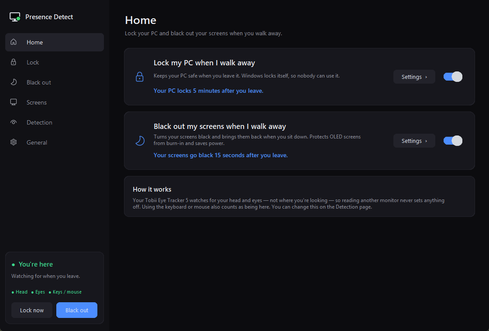
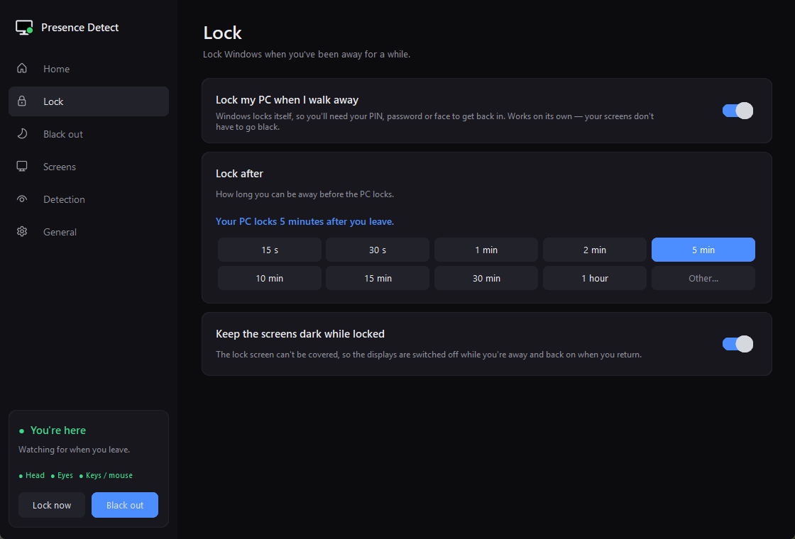
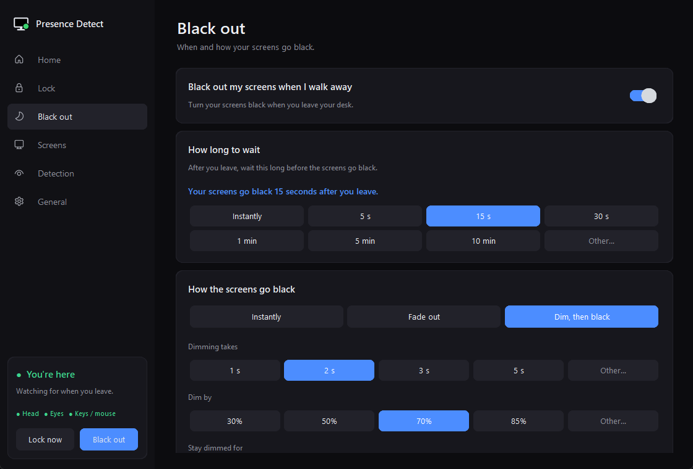
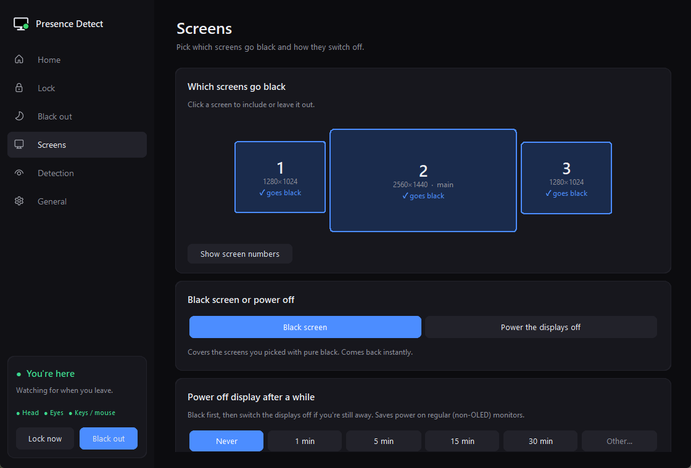
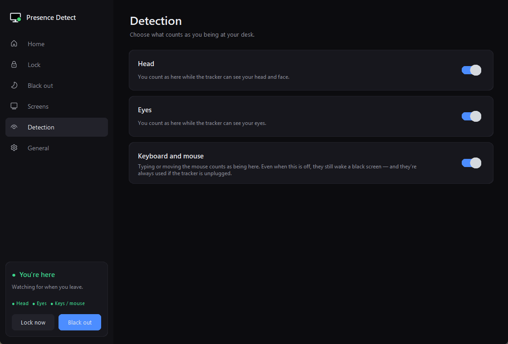
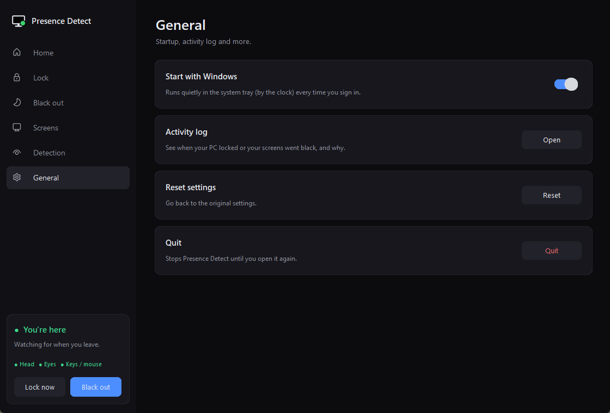

# Tobii Tracker 5 – Presence Detect

**Lock your PC and/or black out your screens when you walk away** — using the **Tobii Eye Tracker 5** to sense whether you're at your desk.

It watches for your **head and eyes**, not where you're looking, so reading another monitor never sets anything off. Using the keyboard or mouse also counts as being there.

Two features, each with its own on/off switch — use either one, or both:

- 🔒 **Lock my PC when I walk away** — Windows locks itself after you've been gone for the time you choose. Nobody can use your PC while you're away.
- 🌙 **Black out my screens when I walk away** — your screens turn pure black and come back the moment you sit down. Protects OLED screens from burn-in and saves power.



## Download

**[⬇ Download PresenceDetect.exe](https://github.com/Adaaks/Tobii-Tracker-5-Presence-Detect/releases/latest/download/PresenceDetect.exe)** — no install, no Python needed. Just double-click it.

You need a **Tobii Eye Tracker 5** with **Tobii Experience** installed (Windows 10 or 11).

> Windows may show *"Windows protected your PC"* the first time, because the app isn't signed. Click **More info → Run anyway**.

The app opens its settings window and adds an icon to the system tray (by the clock). Settings are saved in `%APPDATA%\PresenceDetect`.

## Features

**Lock**
- Lock after 15 seconds, 30 seconds, 1 minute … 1 hour, or type your own (`90s`, `10m`, …)
- Works on its own — your screens don't have to go black
- **Keep the screens dark while locked** — the Windows lock screen can't be covered, so the displays are switched off while you're away and back on when you return

**Black out**
- Go black instantly, after a few seconds, after minutes, or type your own
- **Instant**, **fade out**, or **dim, then black** (a heads-up dim before it goes fully black) — the fade runs at your monitor's refresh rate
- Pick which screens go black on a map of your monitors
- Black screen (instant wake) or use your monitors' own power saving
- Optionally power the displays off after they've been black for a while

**Detection**
- Choose what counts as you being at your desk: **head**, **eyes**, and **keyboard & mouse** — each can be switched off (all on by default, at least one stays on)
- The keyboard and mouse always wake a black screen, even when they don't count as being there

**Everything else**
- **Lock now** and **Black out now** buttons, in the app and in the tray menu
- Lives in the system tray, starts with Windows, and uses very little CPU (well under 1% of one core) and about 30 MB of RAM
- **Works alongside games** — it only reads from the tracker, so Tobii game integration keeps working, and the black screens never steal focus
- **Tracker unplugged?** It tells you, goes by keyboard and mouse only (waiting at least 5 minutes), and reconnects by itself when you plug it back in

## Screenshots

| | |
|---|---|
|  |  |
|  |  |
|  | |

## Default settings

| Setting | Default |
|---|---|
| Lock my PC when I walk away | **Off** (locks after 5 minutes when switched on) |
| Black out my screens when I walk away | On — instantly, no transition |
| Screens | All |
| Detection | Head, eyes, and keyboard & mouse all on |
| Start with Windows | On |

## Run from source

Prefer Python? You'll need:

- Windows 10 or 11
- A **Tobii Eye Tracker 5** with **Tobii Experience** installed (it provides `tobii_stream_engine.dll`, which this app uses to talk to the tracker)
- **Python 3.10+**

Then:

```bash
git clone https://github.com/Adaaks/Tobii-Tracker-5-Presence-Detect.git
cd Tobii-Tracker-5-Presence-Detect
pip install -r requirements.txt
pythonw presence_detect.py
```

The settings window opens and an icon appears in the system tray (by the clock). Closing the window keeps it running in the tray — click the tray icon to open it again. With **Start with Windows** on (the default), it starts quietly in the tray every time you sign in.

Other options:

```bash
pythonw presence_detect.py --background   # start hidden in the tray
python presence_detect.py --test          # live readout of what it senses (takes no action)
```

Shortcuts: **Ctrl + Alt + B** black out now · **Ctrl + Alt + End** quit.

## Good to know

- If the tracker sometimes loses you for a moment (for example when you turn far towards a side monitor), a short wait like **5 s** before blacking out avoids brief accidental blackouts. For locking, a minute or more is usually comfortable.
- **"Power the displays off"** uses the monitors' own power saving, so it affects every screen and waking takes a second or two.
- Settings are saved in `presence_detect_settings.json` (in `%APPDATA%\PresenceDetect` for the .exe, next to the script otherwise), and events (lock, black out, wake, tracker connected/disconnected) in `presence_detect.log`.
- Coming from **Presence Blackout** (the old name)? Your settings are picked up automatically.

## Privacy

Everything runs locally. Nothing is sent anywhere, and no gaze or head data is stored — the log only records events like "lock", "black out" and "wake".

## Files

| File | What it is |
|---|---|
| `presence_detect.py` | The app |
| `tobii_stream.py` | Small reader for the Tobii Stream Engine (presence, head and gaze) |

*Not affiliated with or endorsed by Tobii. Tobii and Tobii Eye Tracker 5 are trademarks of Tobii AB.*
