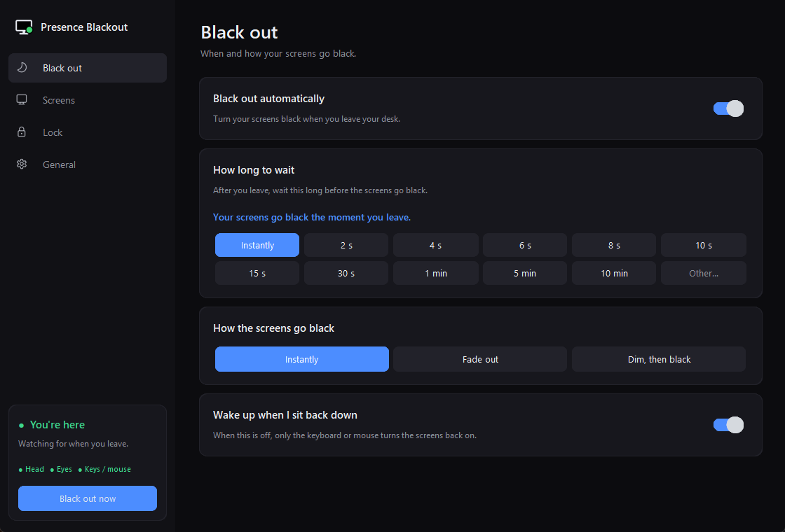
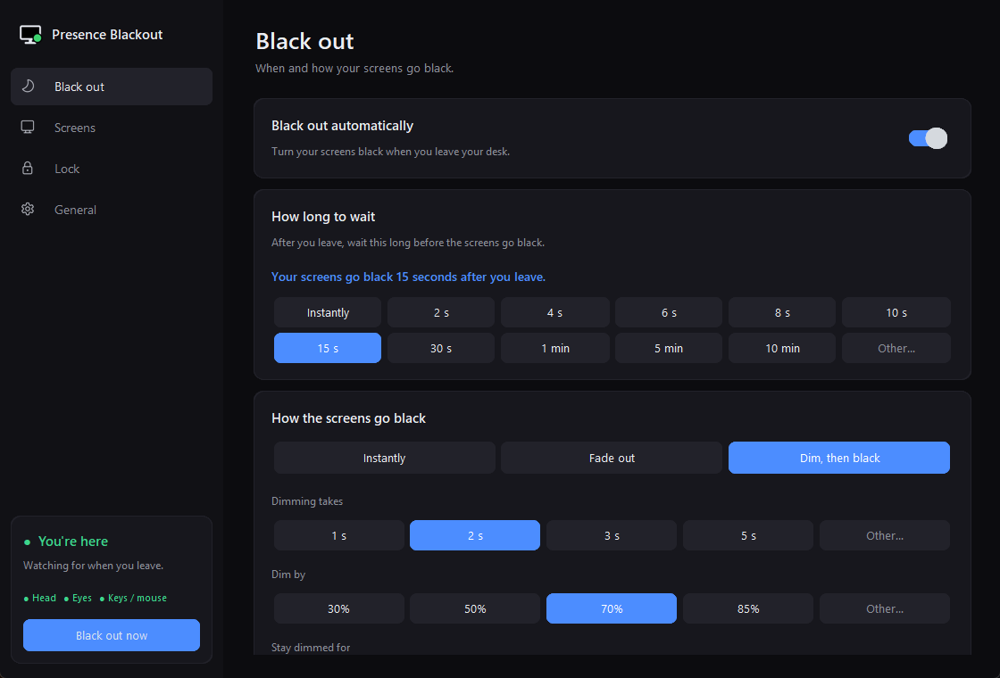
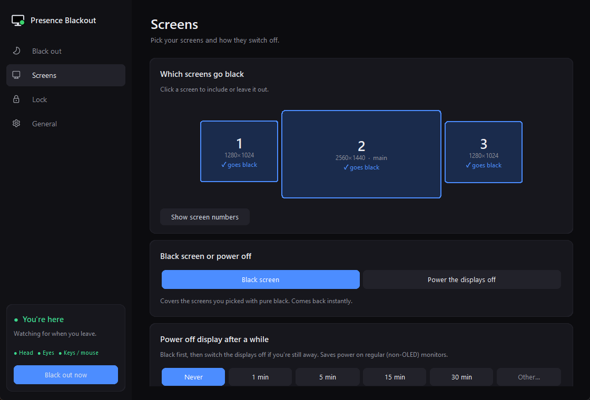
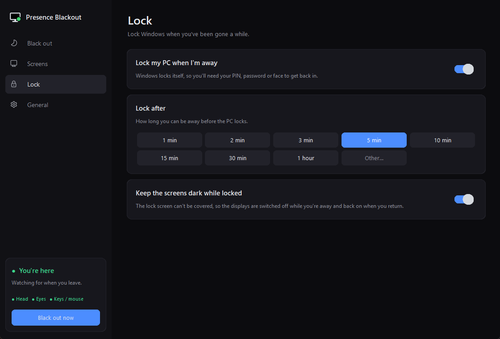
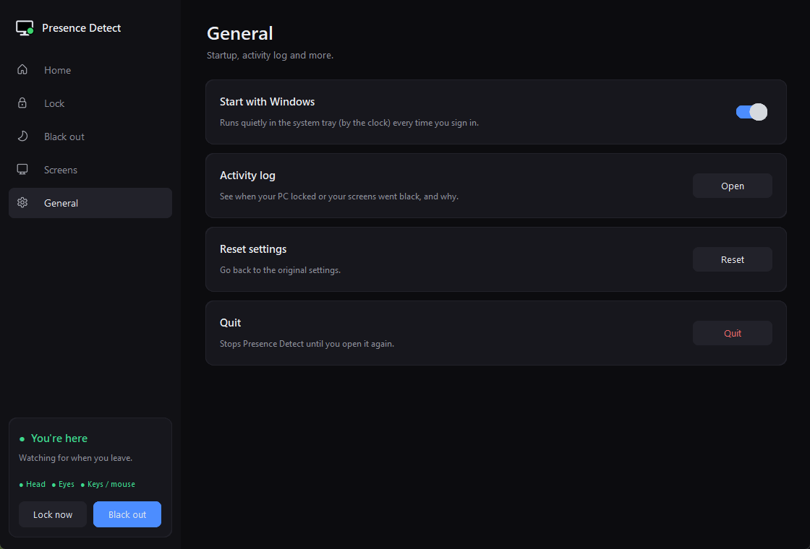

# Tobii Tracker 5 – Presence Blackout

Turns your monitors **pure black the moment you leave your desk**, and brings them back the moment you sit down — using the **Tobii Eye Tracker 5** to sense whether you're there.

It looks for your **head and eyes**, not where you're looking, so glancing at another monitor never triggers it. Great for OLED screens (no burn-in from a static desktop while you grab a coffee), privacy, and saving power.



## Download

**[⬇ Download PresenceBlackout.exe](https://github.com/Adaaks/Tobii-Tracker-5-Presence-Blackout/releases/latest/download/PresenceBlackout.exe)** — no install, no Python needed. Just double-click it.

You need a **Tobii Eye Tracker 5** with **Tobii Experience** installed (Windows 10 or 11).

> Windows may show *"Windows protected your PC"* the first time, because the app isn't signed. Click **More info → Run anyway**.

The app opens its settings window and adds an icon to the system tray (by the clock). Settings are saved in `%APPDATA%\PresenceBlackout`.

## Features

- **Presence detection** – uses the tracker's head and eye tracking plus your keyboard and mouse. Your screens only go black when *none* of them say you're there.
- **You choose the timing** – instantly, a few seconds, minutes, or type any value (`45s`, `2m`, …).
- **Smooth transitions** – instant, a fade, or *dim then black* (a heads-up dim before it goes fully black). The fade runs at your monitor's refresh rate.
- **Pick your screens** – click the screens on a map to include or leave them out.
- **Black screen or power off** – cover the screens with pure black (instant wake), or use the monitors' own power saving. Optionally power the displays off after they've been black for a while.
- **Optional auto-lock** – lock Windows after you've been away for a while, and keep the displays dark on the lock screen until you return.
- **Lives in the system tray**, starts with Windows, and uses very little CPU (well under 1% of one core) and about 30 MB of RAM.
- **Works alongside games** – it only reads from the tracker, so Tobii game integration keeps working, and the black screens never steal focus.
- **No tracker? No problem** – if the Tobii is unplugged it says so, falls back to a normal 5-minute keyboard/mouse screensaver, and reconnects by itself when you plug it back in.

## Screenshots

| | |
|---|---|
|  |  |
|  |  |

## Run from source

Prefer Python? You'll need:

- Windows 10 or 11
- A **Tobii Eye Tracker 5** with **Tobii Experience** installed (it provides `tobii_stream_engine.dll`, which this app uses to talk to the tracker)
- **Python 3.10+**

Then:

```bash
git clone https://github.com/Adaaks/Tobii-Tracker-5-Presence-Blackout.git
cd Tobii-Tracker-5-Presence-Blackout
pip install -r requirements.txt
pythonw presence_blackout.py
```

The settings window opens and an icon appears in the system tray (by the clock). Closing the window keeps it running in the tray — click the tray icon to open it again. With **Start with Windows** on (the default), it starts quietly in the tray every time you sign in.

Other options:

```bash
pythonw presence_blackout.py --background   # start hidden in the tray
python presence_blackout.py --test          # live readout of what it senses (never blacks out)
```

Shortcuts: **Ctrl + Alt + B** black out now · **Ctrl + Alt + End** quit.

## Default settings

| Setting | Default |
|---|---|
| Wait before black out | Instantly |
| How the screens go black | Instantly |
| Screens | All |
| Lock my PC when I'm away | **Off** |
| Start with Windows | On |

## Good to know

- **The Windows lock screen can't be covered** by any app. With *Keep the screens dark while locked* on, the displays are switched off instead while you're away, and switched back on when you return.
- **"Power the displays off"** uses the monitors' own power saving, so it affects every screen and waking takes a second or two.
- If the tracker sometimes loses you for a moment (for example when you turn far towards a side monitor), a short wait like **2–4 s** avoids brief accidental blackouts.
- Settings are saved in `presence_blackout_settings.json` (in `%APPDATA%\PresenceBlackout` for the .exe, next to the script otherwise), and events (black out, wake, lock, tracker connected/disconnected) in `presence_blackout.log`.

## Privacy

Everything runs locally. Nothing is sent anywhere, and no gaze or head data is stored — the log only records events like "black out" and "wake".

## Files

| File | What it is |
|---|---|
| `presence_blackout.py` | The app |
| `tobii_stream.py` | Small reader for the Tobii Stream Engine (presence, head and gaze) |

*Not affiliated with or endorsed by Tobii. Tobii and Tobii Eye Tracker 5 are trademarks of Tobii AB.*
